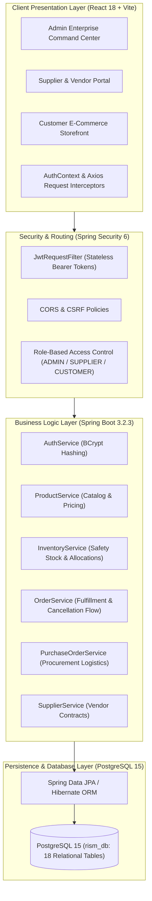

# Retail Inventory & Enterprise Supply Chain Management System (RISM)

[](https://spring.io/projects/spring-boot)
[](https://react.dev/)
[](https://www.typescriptlang.org/)
[](https://www.postgresql.org/)
[](https://tailwindcss.com/)
[](https://www.docker.com/)

A modular monolithic enterprise application designed for end-to-end retail inventory tracking, automated warehouse logistics, vendor procurement, customer order processing, and executive business analytics.

---

## 🔑 Administrator Portal Credentials

To evaluate or view the **Admin Command Center**, use the following administrator credentials:

| Field | Value |
| :--- | :--- |
| **Portal Login URL** | [http://localhost:5173/login](http://localhost:5173/login) |
| **Username** | `tanmay_garg06` |
| **Password** | `$Tanmay@06` |
| **Email** | `tanmaylkgarg@gmail.com` |
| **Role** | `ROLE_ADMIN` (Full System Administration) |

> 📌 **Complete Account Directory:** Full list of demo accounts (Customer, Supplier, Warehouse Staff) is maintained in **[`PASSWORDS.md`](PASSWORDS.md)** and **[`password.txt`](password.txt)**.

---

## 🏛️ System Architecture

The application follows a **Layered Modular Monolith** architecture with strict separation of concerns, enterprise-grade stateless authentication, and real-time inventory synchronization.



---

## 📦 Key System Modules & Features

### 1. Executive Admin Command Center
- **Interactive KPI Cards:** Real-time metrics for total active stock, reserved allocations, low-stock alerts, active vendor contracts, and open orders.
- **Stock Flow Analytics (In vs Out):** Dynamic Recharts visualization comparing incoming procurement goods against outgoing sales volume in ₹ INR.
- **Quick-Action Dispatcher:** One-click shortcuts to receive purchase orders, fulfill shipments, or audit supplier contracts.

### 2. Product Catalog & Image Management
- **Visual Catalog Grid:** Live image rendering with fallback badges.
- **Custom Image Upload:** Add products with custom external image URLs directly through the modal dialog.
- **Dynamic Pricing & Discounts:** Apply percentage markdowns or surcharges on the fly.
- **Categorization:** Products mapped across Electronics, Fashion, Home & Kitchen, Books, Sports, and Beauty categories.

### 3. Core Inventory & Stock Reservation
- **Multi-Warehouse Allocation:** Tracks `totalQuantity`, `availableQuantity`, and `reservedQuantity` per SKU per warehouse location.
- **Automated Reservation:** Placing an order reserves inventory immediately to prevent overselling.
- **Safe Order Cancellation:** If an order is cancelled by an Admin, the reserved stock is automatically credited back to `availableQuantity`.

### 4. Order Management & Fulfillment Center
- **Master Order Log:** View all customer transactions, total values, timestamps, and customer details.
- **Kanban-Style Fulfillment Board:** Drag/move orders through `PENDING` ➔ `CONFIRMED` ➔ `PROCESSING` ➔ `SHIPPED` ➔ `DELIVERED`.
- **Cancellation Controls:** Prominent red cancellation action with confirmation prompts and instant stock rebalancing.

### 5. Supplier & Vendor Management
- **Vendor Directory:** Track account managers, email, phone, and contract status.
- **Safe Deletion Guard:** Permanently visible edit/delete controls with backend foreign-key protection that blocks deletion if active purchase orders or user accounts are bound to the supplier.

### 6. Customer E-Commerce Portal
- **Curated Storefront:** Browse catalog by categories (Trending, New Arrivals, Sale collections).
- **Persistent Shopping Cart:** Client-side cart with real-time quantity adjustments and total calculation.
- **Order Tracking Timeline:** Visual progress steps for active orders, with an alert banner replacing the timeline if an order is cancelled.

---

## 🛠️ Technology Stack

| Layer | Technology | Details |
| :--- | :--- | :--- |
| **Frontend Framework** | React 18.2 | Vite build tool, Single Page Application (SPA) |
| **Language** | TypeScript 5.2 | Strict typing across DTOs and interfaces |
| **Styling** | Tailwind CSS 3.4 | Custom responsive layout with modern utility styling |
| **Icons & Charts** | Lucide React & Recharts | Vector iconography and real-time SVG charting |
| **HTTP Client** | Axios | Request/Response interceptors injecting Bearer JWT |
| **Backend Framework** | Spring Boot 3.2.3 | Java 17 / 21 modular backend |
| **Security** | Spring Security 6 & JWT | HMAC-SHA256 tokens (30-day session lifespan) |
| **ORM & Data** | Spring Data JPA / Hibernate | High-performance PostgreSQL abstraction |
| **Database** | PostgreSQL 15 | Containerized relational database (`rism_db`) |
| **Containerization** | Docker & Docker Desktop | Multi-container architecture via Docker Compose |

---

## 🚀 How to Run the Project (Step-by-Step)

### Prerequisites
Make sure the following tools are installed on your machine:
- **Java Development Kit (JDK 17 or 21)**
- **Node.js (v18 or higher)** and `npm`
- **Docker Desktop** (running on Windows/Linux/macOS)
- **Git**

---

### Step 1: Start the PostgreSQL Database
Open a terminal in the project root directory (`E:\HCL Project`):

```bash
# Start Docker Desktop if not already running
# Launch PostgreSQL container
docker-compose up -d postgres
```

Verify that the database is running and accepting connections:
```bash
docker ps
# Look for container: rism_postgres on port 0.0.0.0:5432->5432/tcp
```

> 💡 **Database Seed / Data Restoration:** The complete database state with 36 products, 37 inventory records, orders, and users is saved in **`database_dump.sql`**. To restore:
> ```bash
> docker exec -i rism_postgres psql -U rism_user -d rism_db < database_dump.sql
> ```

---

### Step 2: Start the Spring Boot Backend
Open a new terminal and navigate to the `backend` folder:

```bash
cd backend

# On Windows:
.\mvnw spring-boot:run

# On Linux / macOS:
./mvnw spring-boot:run
```

Once started, the backend API is live at **`http://localhost:8080`**.
- Public catalog endpoints: `http://localhost:8080/api/products`
- API Health & Swagger Documentation: `http://localhost:8080/swagger-ui.html`

---

### Step 3: Start the Vite React Frontend
Open another terminal and navigate to the `frontend` folder:

```bash
cd frontend

# Install dependencies (first time only)
npm install

# Start Vite dev server
npm run dev
```

The frontend application will be live at **`http://localhost:5173`**.

---

### Step 4: Log into the Admin Portal
1. Open your browser and go to: **`http://localhost:5173/login`**
2. Enter the Administrator credentials:
   - **Username**: `tanmay_garg06`
   - **Password**: `$Tanmay@06`
3. Click **SIGN IN** to access the full **Enterprise Command Center**.

---

## 🗄️ Database Architecture & Schema

The relational database (`rism_db`) contains **18 relational tables** designed in 3NF:

| Table | Purpose |
| :--- | :--- |
| `users` | User credentials, contact info, status, and supplier references |
| `roles` | System roles (`ROLE_ADMIN`, `ROLE_CUSTOMER`, `ROLE_SUPPLIER`, `ROLE_USER`) |
| `user_roles` | Many-to-many relationship mapping users to security roles |
| `categories` | Product departments (Electronics, Fashion, Books, Home, Sports, Beauty) |
| `products` | SKU, product name, description, cost price, selling price, image URL |
| `warehouses` | Physical storage sites with location codes and contact info |
| `inventory` | Core junction table managing `available_quantity` and `reserved_quantity` |
| `inventory_transactions` | Audit log of all stock intake, adjustments, and order reductions |
| `stock_transfers` | Inter-warehouse inventory movement tracking |
| `suppliers` | Registered supplier vendor profiles and contact contracts |
| `purchase_orders` | Procurement orders issued to suppliers |
| `purchase_order_items` | Line items for purchase orders with received counts |
| `customers` | Customer profiles and shipping addresses |
| `orders` | Sales orders placed by customers |
| `order_items` | Items contained in customer orders with unit pricing |
| `shipments` | Carrier tracking details and delivery milestones |
| `notifications` | System notifications with priority and read states |
| `audit_logs` | Security and compliance tracking of sensitive operations |

---

## 📂 Project Directory Structure

```text
HCL Project/
├── backend/                               # Spring Boot 3.2.3 Application
│   ├── src/main/java/com/hcl/inventory/
│   │   ├── config/                        # SecurityConfig, CorsConfig
│   │   ├── controller/                    # REST API Endpoints (Auth, Product, Order, etc.)
│   │   ├── dto/                           # Request/Response Data Transfer Objects
│   │   ├── entity/                        # JPA Entities (Product, Inventory, Order, etc.)
│   │   ├── repository/                    # Spring Data JPA Repositories
│   │   ├── security/                      # JwtRequestFilter, JwtUtil, UserDetailsService
│   │   └── service/                       # Business Logic (OrderService, InventoryService, etc.)
│   ├── src/main/resources/
│   │   └── application.yml                # Database & Server configuration
│   ├── pom.xml                            # Maven dependencies & build plugins
│   └── mvnw / mvnw.cmd                    # Maven wrappers
├── frontend/                              # React 18 + Vite Frontend
│   ├── src/
│   │   ├── components/                    # Layout, Navbar, Sidebar
│   │   ├── pages/                         # Dashboard, ProductCatalog, Orders, Suppliers, etc.
│   │   ├── services/                      # Axios HTTP client configuration
│   │   ├── store/                         # AuthContext (JWT handling, Cart state)
│   │   ├── types/                         # TypeScript interfaces
│   │   └── App.tsx                        # React Router configuration
│   ├── package.json                       # NPM scripts and dependencies
│   └── vite.config.ts                     # Vite build configuration
├── database/                              # SQL Schema definitions
│   ├── schema.sql                         # Table definitions
│   └── seed.sql                           # Initial seed records
├── database_dump.sql                      # Complete live PostgreSQL data dump
├── docker-compose.yml                     # Multi-container Docker configuration
├── PASSWORDS.md                           # Credentials and account directory
├── password.txt                           # Quick credentials text reference
├── Retail Inventory SRS.pdf               # Software Requirements Specification
├── Retail Inventory PPT.pptx              # Presentation Slide Deck
├── Tanmay_Garg_SRS_Report.docx            # Detailed SRS Word Document
└── README.md                              # Main documentation (this file)
```

---

## 📡 REST API Summary

| Method | Endpoint | Access | Description |
| :--- | :--- | :--- | :--- |
| `POST` | `/api/auth/login` | Public | Authenticate user & return JWT token |
| `POST` | `/api/auth/register` | Public | Register new customer or supplier account |
| `GET` | `/api/users/me` | Authenticated | Retrieve authenticated user profile |
| `GET` | `/api/products` | Public | Fetch complete product catalog |
| `POST` | `/api/products` | `ADMIN` | Create new product with image URL |
| `PUT` | `/api/products/{id}` | `ADMIN` | Update product details / pricing |
| `DELETE` | `/api/products/{id}` | `ADMIN` | Delete product from catalog |
| `GET` | `/api/inventories` | Authenticated | Fetch warehouse inventory allocations |
| `GET` | `/api/orders` | Authenticated | List all customer orders |
| `POST` | `/api/orders` | Authenticated | Place new customer order (reserves stock) |
| `PUT` | `/api/orders/{id}/status` | Authenticated | Update order status (Cancels release stock) |
| `GET` | `/api/suppliers` | Authenticated | List registered supplier contracts |
| `DELETE` | `/api/suppliers/{id}` | `ADMIN` | Safely delete supplier contract |

---

## 📄 Project Documentation Deliverables

The repository includes all capstone project documentation:
1. **[`Retail Inventory SRS.pdf`](Retail%20Inventory%20SRS.pdf)** - Complete IEEE-standard Software Requirements Specification.
2. **[`Tanmay_Garg_SRS_Report.docx`](Tanmay_Garg_SRS_Report.docx)** - Full documentation report in Word format.
3. **[`Retail Inventory PPT.pptx`](Retail%20Inventory%20PPT.pptx)** - Comprehensive presentation slide deck for review and defense.
4. **[`PASSWORDS.md`](PASSWORDS.md)** - Credentials directory for reviewers and evaluators.

---

## 👨‍💻 Project Author
- **Developer:** Tanmay Garg
- **Email:** [tanmaylkgarg@gmail.com](mailto:tanmaylkgarg@gmail.com)
- **GitHub:** [@tanmaygarg06](https://github.com/tanmaygarg06)
- **Repository:** [https://github.com/tanmaygarg06/Retail-Inventory.git](https://github.com/tanmaygarg06/Retail-Inventory.git)
