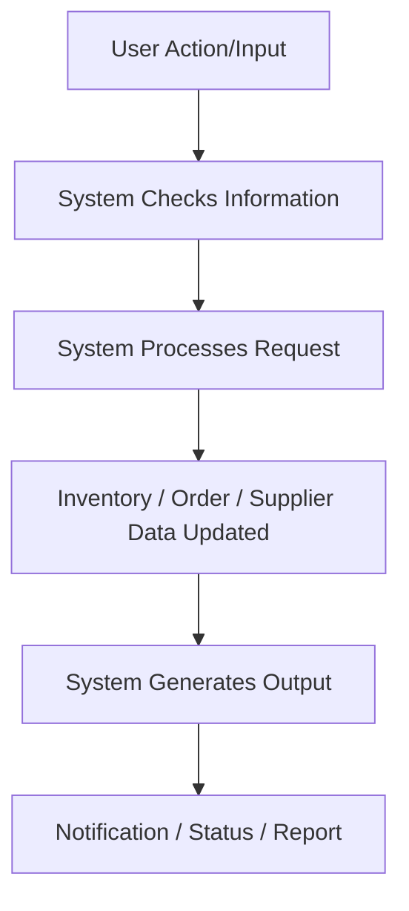

# Retail Inventory Management System

## 1. Project Title
**Retail Inventory Management System**

## 2. Problem Statement
Retail businesses often face significant challenges in managing their inventory efficiently, especially when operating across multiple warehouses. Without a centralized system, companies struggle with incorrect or outdated stock information, leading to critical issues like stock shortages or costly overstocking. Tracking where a specific product is available becomes a time-consuming manual task, which delays customer service and order processing.

Additionally, the reliance on manual supplier and purchase tracking makes it difficult to maintain timely stock replenishment. The lack of automated low-stock alerts means inventory managers may miss crucial reorder windows. Furthermore, without a centralized view of inventory, order fulfillment, and supplier activities, businesses find it difficult to check inventory before processing orders and track vital inventory changes, ultimately hurting overall operational efficiency.

## 3. What the System Does
The Retail Inventory Management System provides a unified, centralized platform for businesses to manage their daily operations smoothly. It offers an easy-to-use interface to oversee **products, warehouses, inventory, suppliers, purchase orders, customer orders, order fulfillment, and reports/notifications** in one place. 

From a user perspective, the system seamlessly handles the entire lifecycle of retail operations. It provides instant visibility into stock levels, alerts users when stock is low, and simplifies the complex process of managing orders from creation to delivery. By focusing on practical usability, the system ensures that users have immediate access to the right information to make informed decisions.

## 4. Modules and Their Working

| Module Name | Working |
| :--- | :--- |
| **Authentication** | Allows users to log in and access features securely. |
| **Dashboard** | Shows a summary of current inventory, low-stock products, and recent orders. |
| **Product Catalog** | Allows users to add, update, search and view product details. |
| **Inventory** | Tracks stock quantities, manages stock-in, and handles stock-out activities. |
| **Suppliers** | Stores and manages basic supplier information for stock replenishment. |
| **Orders** | Allows users to create customer orders and check available stock before confirming. |

## 5. User Input → System Output

| User Input / Action | System Processing / Response | System Output |
| :--- | :--- | :--- |
| Add a product | System records product information | Product appears in catalog. |
| Add stock | System updates warehouse inventory | Updated stock is displayed. |
| Create customer order | System checks available stock | Stock availability/order status is shown. |
| Product reaches reorder level | System identifies low stock | Low-stock notification is generated. |
| Request warehouse transfer | System checks source stock | Transfer is recorded and inventory is updated. |
| Receive purchased goods | System adds received quantity | Warehouse inventory increases. |
| Create purchase order | System records supplier and products | Purchase order is created. |
| Update order status | System records the status | Current order status is displayed. |
| Search for product | System checks inventory | Warehouse-wise availability is displayed. |
| Open dashboard | System summarizes current data | Inventory, orders and purchases are displayed. |

## 6. Industry Uses

| Industry Need | System Use | Benefit |
| :--- | :--- | :--- |
| **Inventory Management** | Centralizes and updates stock information. | Prevents stockouts and overstocking. |
| **Multi-Warehouse Management**| Tracks stock across different locations. | Easy identification of product locations. |
| **Stock Replenishment** | Identifies low-stock products. | Supports timely purchasing and avoids delays. |
| **Procurement Management** | Manages suppliers and purchase orders. | Streamlines vendor communication. |
| **Order Management** | Checks stock before confirming customer orders. | Ensures accurate customer commitments. |
| **Order Fulfillment** | Tracks picking, packing, shipping and delivery. | Improves order processing speed and accuracy. |
| **Business Monitoring** | Dashboards and reports monitor operations. | Helps managers make informed, data-driven decisions. |
| **Traceability** | Records important inventory and operational changes. | Ensures accountability and clear activity history. |

## 7. Users of the System

| User | Main Activities |
| :--- | :--- |
| **Admin** | • Manage users and roles   • Monitor system activities |
| **Inventory Manager** | • Monitor stock   • Manage low-stock items   • Handle inventory adjustments and transfers |
| **Warehouse Manager**| • Monitor warehouse stock   • Manage stock movement   • Handle fulfillment activities |
| **Procurement Manager**| • Manage suppliers   • Create purchase orders   • Handle replenishment and received goods |
| **Order Manager** | • Create/manage customer orders   • Check stock availability   • Monitor order status and fulfillment |

## 8. Main Business Flow

**Practical Sub-Flows:**

* **Low Stock:**  
  Low Stock Detected → Notification → Purchase Order → Goods Received → Inventory Updated

* **Warehouse Transfer:**  
  Transfer Request → Check Source Stock → Transfer Stock → Source Decreases → Destination Increases

* **Customer Order:**  
  Create Order → Check Stock → Reserve Stock → Confirm Order → Fulfillment → Delivery

## 9. Questions the System Answers
* **How much stock do we currently have?** It provides real-time tracking of overall and available stock.
* **Which products are low in stock?** It actively monitors thresholds to flag low-stock items.
* **Which warehouse has a particular product?** It provides instant warehouse-wise inventory visibility.
* **How much stock is available for an order?** It checks unreserved stock before confirming orders.
* **Which products need to be purchased?** It highlights requirements through low-stock lists.
* **What purchase orders are pending?** It displays trackable statuses for all supplier orders.
* **Have purchased goods been received?** It logs received statuses and updates inventory accordingly.
* **What is the current status of an order?** It offers live tracking of fulfillment stages.
* **Which warehouse needs or has excess stock?** It provides multi-warehouse dashboard summaries.
* **What are the recent inventory and order activities?** It retains activity records and operational reports.

## 10. Conclusion
The **Retail Inventory Management System** helps retail businesses manage inventory, warehouses, procurement, suppliers, orders and fulfillment through one centralized system. It improves stock visibility, supports timely replenishment, helps coordinate warehouses and provides useful information for daily business operations. By resolving common inventory hurdles and streamlining communication across departments, the system enables retail businesses to operate efficiently and meet customer demands reliably.
